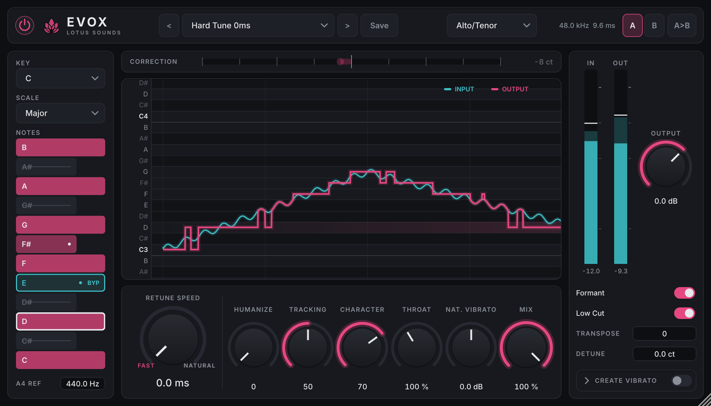

# EVOX — Lotus Sounds

Real-time vocal pitch correction tuned for the mid/late-2000s hard-tune sound:
- stepped note jumps at fast retune speeds,
- a bright, slightly glassy TD-PSOLA texture,
- tight, low-latency tracking on fast runs,
- independent formant ("throat") control.

It's a clean-room design built on published DSP techniques: YIN pitch detection, TD-PSOLA
pitch shifting, and grain-resampling formant shifting. No third-party DSP code.



| | |
|---|---|
| Formats | VST3 + AU (macOS universal arm64/x86_64), VST3 (Windows, Linux), Standalone. AAX-ready structure |
| Latency | constant, **< 10 ms** at every sample rate (9.65 ms at 48 kHz) |
| CPU | 1.3% of one core at 48 kHz / 128, stereo (2.8% worst case with 2× oversampling) |
| Validation | 40 DSP unit tests, 10 plugin-layer tests, pluginval strictness 5 (Linux VST3 here; macOS/Windows/AU via CI) |

---

## Building

You need:
- CMake 3.22 or later
- A C++20 compiler: Xcode 14+, Visual Studio 2022, GCC 11+ or Clang 14+
- Git

JUCE 8.0.15 is fetched automatically. To use an existing checkout instead, add
`-DFETCHCONTENT_SOURCE_DIR_JUCE=/path/to/JUCE`.

```bash
# macOS — universal VST3 + AU + Standalone
cmake -B build -G Xcode
cmake --build build --config Release

# Windows — VST3 + Standalone
cmake -B build -G "Visual Studio 17 2022"
cmake --build build --config Release

# Linux — VST3 + Standalone
sudo apt install libasound2-dev libx11-dev libxrandr-dev libxinerama-dev libxcursor-dev \
                 libxext-dev libfreetype-dev libfontconfig1-dev libgl1-mesa-dev
cmake -B build -G Ninja -DCMAKE_BUILD_TYPE=Release
cmake --build build
```

Artefacts are in `build/EVOX_artefacts/Release/{VST3,AU,Standalone}/`. To install:

| OS | VST3 | AU |
|---|---|---|
| macOS | `~/Library/Audio/Plug-Ins/VST3/` | `~/Library/Audio/Plug-Ins/Components/` (then `auval -v aufx Evox Ltsd`) |
| Windows | `C:\Program Files\Common Files\VST3\` | – |
| Linux | `~/.vst3/` | – |

To have the build install them for you, set `COPY_PLUGIN_AFTER_BUILD TRUE` in `CMakeLists.txt`.

### CMake options

| Option | Default | What it builds |
|---|---|---|
| `EVOX_BUILD_PLUGIN` | ON | the plugin (needs JUCE) |
| `EVOX_BUILD_TESTS` | ON | DSP unit tests + offline tools (no JUCE needed) |
| `EVOX_BUILD_PLUGIN_TESTS` | ON | JUCE-level plugin tests (`evox_plugin_tests`) |
| `EVOX_BUILD_SNAPSHOT` | OFF | `evox_snapshot`, which renders the real UI to PNG |

---

## Testing

```bash
ctest --test-dir build -C Release --output-on-failure     # DSP + plugin-layer tests
# DSP only, without JUCE:
cmake -B build-tests -DEVOX_BUILD_PLUGIN=OFF && cmake --build build-tests && ./build-tests/tests/evox_tests [filter]

pluginval --strictness-level 5 --validate build/EVOX_artefacts/Release/VST3/EVOX.vst3
```

**DSP tests (40).** These cover:
- FFT and filters.
- Pitch accuracy on sines, saws, sweeps and synthetic voices at 44.1, 48 and 96 kHz.
- Octave-error traps and voicing on noise, "sss" and silence.
- Scale and hysteresis logic, and the retune, humanize and vibrato maths.
- **Stepped output at 0 ms retune, measured on the rendered audio.**
- Formant envelope position.
- Character tilt.
- Oversampling: filter response, delay, aliasing, timing and click-free switching.
- Latency on every path.
- An allocation probe that fails if `EvoxEngine::process()` allocates once.

**Plugin tests (10).** These cover:
- Host latency matches the engine.
- State round-trip, and corrupt state is ignored.
- All five factory presets render finite audio and appear as host programs.
- User preset save and load.
- A/B compare.
- Both bypass paths are latency-aligned.
- Bus layouts, the oversampling parameter, and mono operation.

**CI** (`.github/workflows/ci.yml`) builds and tests on macOS (universal), Windows and Linux,
then runs pluginval at strictness 5 on each. On macOS it also runs `auval` + pluginval on the
AU and checks with `lipo` that the binary contains both architectures.

### Offline tools

```bash
./build-tests/tools/evox_render vocal.wav tuned.wav --retune 0 --key A --scale minor --character 80 [--os2x]
#   --humanize --transpose --throat --formant on|off --vibrato sine|square|saw --mix --type soprano|alto|low|instrument
./build-tests/tools/evox_analyze vocal.wav f0.csv --type alto --tracking 50      # f0 / confidence / voicing per hop
python3 tools/plot_f0.py in.csv --output-track tuned.csv -o compare.png       # cyan input vs pink output (matplotlib)
./build-tests/tools/evox_gensignals tools/out/signals 48000                    # synthetic benchmark set + ground truth
./build-tests/tools/evox_bench 48000 128 20 [--os2x] [--worst]                 # CPU % of one core
evox_snapshot out.png [w h scale] [--retune ms] [--expand-vibrato] [--bench-paint]  # UI render / paint cost
```

Use these to benchmark against the era's reference recordings. Render a dry acapella with
`evox_render`, then compare its pitch track (`evox_analyze` + `plot_f0.py --output-track`)
against the input.

### Testing in a DAW

1. Load **Hard Tune 0ms** on a lead vocal and set Key/Scale. Slide between notes: the pink line
   should step, and the correction meter should snap.
2. Sweep **Character** 0 → 100 on a sustained vowel: it goes from smooth to glassy.
3. Set **Transpose +12**, then toggle **Formant**: natural vs chipmunk. Then try **Throat** 60% / 150% with no transpose.
4. Retune 100+ ms with **Humanize**, then **Natural Vibrato** −12 / +12 dB.
5. Click keyboard notes to remove or bypass them, use A/B compare, save a user preset, and
   toggle **2× oversampling** mid-playback: no click, and no latency change.
6. Check s / t / breath sounds stay clean, and that bypass doesn't shift timing.

---

## Architecture

```
source/dsp/      Pure C++20 DSP core — no JUCE. Shared by plugin, tests, tools, future AAX.
  InputConditioner   DC blocker (5 Hz) + optional 60 Hz 2nd-order Butterworth high-pass
  VoicingDetector    energy gate + zero-crossing rate + YIN periodicity, with hysteresis
  Decimator          analysis-only anti-aliased decimation to 20–25 kHz (6th-order Butterworth)
  YinPitchDetector   FFT-based YIN, CMNDF, absolute threshold, parabolic interpolation,
                     subharmonic (octave-up error) check
  PitchAnalyzer      streaming wrapper: hop scheduling, octave-jump rejection ("Tracking"),
                     voicing, timestamps each estimate with the input sample it describes
  ScaleQuantizer     key/scale + per-note enable/remove/bypass, hysteresis
  PitchCorrector     retune (time constant on the correction offset), humanize, natural
                     vibrato scaling, create-vibrato LFO, transpose, detune, reference pitch
  CorrectionTrack    timestamped decisions so each lands on the audio it was measured on
  PitchMarker        glottal-peak pitch marks, phase-coherent from period to period
  PsolaShifter       TD-PSOLA synthesis, Character windows, grain-resampling formants/throat,
                     presence shelf; maps its own timeline onto the base-rate decisions
  Oversampler2x      63-tap half-band up/down sampler for the 2x character stage
  EvoxEngine         owns every stage and the latency budget: voiced/unvoiced crossfade,
                     level match, 1x/2x switching, dry/wet, gain, bypass; publishes analysis
                     frames (lock-free SPSC FIFO) and level meters (atomics) to the UI
  Fft, Biquad, DelayLine, Smoother, SpscFifo   real-time-safe building blocks
source/plugin/   JUCE wrapper: APVTS parameters, processor, presets, A/B, editor
source/plugin/ui/  look-and-feel, knobs, pitch display, keyboard, meters, panels
tests/           DSP unit tests (dependency-free runner) + JUCE plugin tests
tools/           renderer, analyser, signal generator, benchmark, snapshot, plotting
```

**Real-time rules:**
- `prepare()` allocates; `process()` never allocates, locks or does I/O. The allocation probe
  test enforces this across parameter changes, odd block sizes and oversampling switches.
- Parameters are read via cached `std::atomic<float>*`, once per block.
- The UI reads the audio thread only through the SPSC FIFO and atomic meters.

**AAX later:** the engine takes a plain `EngineParams` struct per block and exposes latency
as an integer, so an AAX wrapper only has to fill the struct. To build it, add `AAX` to
`EVOX_FORMATS` and call `juce_set_aax_sdk_path()`. You'll need the Avid SDK and a PACE/iLok
signing agreement.

---

## User interface

Dark studio look: background `#0E0F12`, panels `#17191E`, one accent (lotus pink `#E5487F`
for the corrected output and active controls), and cyan `#3FC1C9` reserved for the
*detected* pitch. Everything is vector-drawn (paths, no bitmaps), so it is crisp at any
HiDPI scale. The window is resizable from 760×440 to 2400×1400 (default 980×560), and the
last size is saved with the session.

| Area | Contents |
|---|---|
| Top bar | Bypass, lotus mark + wordmark, preset browser (‹ › dropdown, Save), Input Type, sample rate + latency, A/B compare (A, B, copy A→B) |
| Left | Key, Scale, vertical one-octave keyboard, A4 reference |
| Centre | Correction meter (±100 ct, 60 fps); scrolling piano-roll pitch display (4 s, cyan input / pink output, target-note band, non-target rows shaded; wheel = zoom, double-click = reset) |
| Control row | Hero **Retune Speed** knob with ms readout and FAST/NATURAL arc labels; Humanize, Tracking, Character, Throat, Natural Vibrato, Mix |
| Right | Input/output meters (RMS body, peak, 1.5 s peak hold, numeric), Output gain, Formant, Low Cut, Transpose, Detune, collapsible Create Vibrato panel (on/off, shape, rate, depth, delay) |

**Keyboard:**
- Pink = correction target.
- Struck through = removed.
- Cyan outline + "BYP" = bypassed (left uncorrected).
- A dot marks a note you overrode.
- Click cycles enabled → removed → bypass. Right-click (or Alt-click) returns the note to "follow Key/Scale".
- The note currently targeted is outlined.

**Knobs:**
- Drag vertically (250 px = full range). Hold **Shift** for 10× finer control.
- Double-click resets to default. The mouse wheel works.
- A value bubble appears on hover and while dragging.
- Click the value under a knob to type a number.
- Host gestures (automation write/touch) come from JUCE's slider handling; only the drag maths is custom.

**Threading:** one 60 Hz editor timer drains the analysis SPSC FIFO into the display's own
history and reads the level meters. Peaks accumulate in atomics (compare-and-swap max), and
the UI collects them with `exchange(0)`, so no transient between two frames is lost. The audio
thread never waits on the UI, and the UI never locks.

**Font:** Inter 4.1, embedded via JUCE BinaryData, with the OpenType `tnum` feature on, so
values never jitter. Inter is under the SIL Open Font License 1.1
(`resources/fonts/Inter-LICENSE.txt`): free to embed and ship in commercial software. Keep the
licence file with the source.

**Presets:** the five factory presets are defined in code as "defaults + overrides"
(`PresetManager.cpp`), so adding parameters later never breaks them. They are also exposed
as host programs. User presets are saved as `.evoxpreset` XML in
`<user app data>/Lotus Sounds/EVOX/Presets/`.

**Repaint budget:** only live components repaint at 60 fps, and only when their content
changed. The pitch display stops repainting when the transport stops, meters repaint only on
visible movement, and the meters and correction bar are opaque so they never trigger a repaint
of the panels behind them. Measured with JUCE's software renderer at 980×560:

* Pitch display: 2.0 ms per frame.
* Correction meter: 0.13 ms.
* Each level meter: 0.07 ms.
* A full-editor repaint (only on resize): ~9 ms.

---

## Correction and pitch shifting

**Correction model.** `output = input + c`, and Retune Speed is the time constant with which
the correction `c` chases `target − input`. At 0 ms `c` is assigned exactly on every 2.7 ms
analysis step: the output is the target note, flat, and it changes the instant the target
does. Nothing in the chain smooths it. The shifter applies a ratio change at the very next
grain, so the jump is a true step. At slower speeds the singer's own movement passes through
and is pulled in gradually.

* **Hysteresis**: 0.15 st around each boundary between allowed notes, so a pitch sitting near a
  boundary doesn't flip back and forth.
* **Humanize**: after ~120 ms on one note, the time constant eases up by as much as
  400 ms × Humanize over the next 0.5 s. Short notes still snap.
* **Natural Vibrato**: the note centre is tracked with a 1.5 Hz two-pole filter, reset at every
  note change so steps never leak into it. The deviation from that centre is the vibrato, and
  `(gain − 1) × vibrato` is added after correction. At slow retune this scales the singer's
  vibrato exactly (±12 dB = ×4 / ×¼). At 0 ms it re-injects vibrato on top of the flat note.
  0 dB leaves the correction result untouched, so the default hard-tune stays flat.
* **Create Vibrato**: sine/square/saw LFO starting at note onset + delay, 100 ms fade-in.
  Square flips instantly (robotic).

**TD-PSOLA.** Pitch marks are placed on the largest positive peak of a 1.2 kHz low-passed copy
of the input, one period apart. Using the same polarity on the same smoothed peak keeps marks
phase-coherent from cycle to cycle, so re-placed grains add without flamming. Synthesis marks
advance by `T_in / ratio`, and each one copies the grain of the nearest analysis mark whose
right edge is already available. A ratio change therefore takes effect at the next grain:
there is no glide in the shifter.

**Character** (0 → 100) morphs the grain window from a 2-period Hann (COLA, smooth) to a
1.3-period Hann³ (short, peaky grains). Short peaky grains give a pitch-synchronous buzz, the
glassy edge. They also cost ~2–3 dB above 3 kHz, so a Character-linked high shelf (3.5 kHz,
up to +5 dB) more than compensates. Measured at unity ratio:

| Character | 0–1 kHz | 1–3 kHz | 3–6 kHz | 6–10 kHz | 10–16 kHz |
|---|---|---|---|---|---|
| 0 (clean) | 0.0 | +0.1 | 0.0 | −0.2 | −1.0 dB |
| 70 (default) | −0.7 | +0.4 | +0.7 | +1.5 | +0.9 dB |
| 100 (hard) | −1.0 | 0.0 | +1.0 | +2.2 | +1.6 dB |

A slow (80 ms) voiced-only level match keeps the shifted path at the input's RMS, because
peaky grains centred on glottal peaks otherwise read up to +3 dB hot.

### Formant / Throat: grain resampling (why not LPC)

Both were allowed by the spec, and LPC was the initial plan. During the synthesis design I
switched to **grain resampling**, because in TD-PSOLA it is the native mechanism:

* Pitch is set only by the *spacing* of grains, and the spectral envelope lives *inside* each
  grain. Reading a grain at speed 1/α stretches it by α and scales its envelope by 1/α, while
  the spacing (pitch) stays put. Formant correction ON is therefore free: plain PSOLA already
  preserves the envelope, and ON simply means α = Throat. OFF sets α = Throat / ratio (chipmunk).
* LPC would add an inverse filter, a re-synthesis filter per channel and an analysis frame.
  It would also need a way to *warp* an all-pole envelope by 50–180%, which means pole-angle
  scaling (root finding) or re-fitting from a warped spectrum. Both are expensive, and the
  first is numerically fragile. Grain resampling costs one interpolated read per sample and
  adds zero latency.
* Detail that matters: the output grain length is set by Character alone, and α only changes
  how much source a grain reads (2H/α). Without this, Throat above ~120% comb-filtered itself
  (stretched grains overlapped with mismatched periodicity), and Throat below 100% smeared the
  envelope.

Measured on a synthetic /a/, using the formant-envelope centroid from `harmonicEnvelopeCentroid`
in the tests:

* Formant correction holds the envelope within 5% at ±12 st.
* With formant correction off, the envelope follows pitch (×1.3 at +12 st, ×0.69 at −12 st).
* Throat 150% gives ×0.73 (ideal 0.71). Throat 70% gives ×1.15 (ideal 1.28). Brightening
  reaches roughly 60% of the ideal in log terms, darkening almost all of it.

### Measured end to end (tests + harness)

* Correction accuracy: output f0 within 0.1–0.5 ct of the target note across 84–450 Hz, with
  and without formant correction and at ±12/+7 st transposes. Level within ±2 dB.
* 0 ms retune on a C3→G3 glide: >85% of frames sit within 8 ct of a semitone, <5% are between
  notes (the step frames). At 250 ms retune >30% of frames are between notes (glide kept).
  Plot: `docs/phase3/glide_retune0.png` vs `glide_retune150.png`.
* Unvoiced noise passes through unshifted (residual < −30 dB) even with +12 st transpose.

---

### Pitch detection

* **YIN** (de Cheveigné & Kawahara 2002). The difference function is computed in O(N log N):
  both correlation operands are packed into one complex FFT, with energy prefix sums.
* **Newest-first framing.** YIN integrates over the first `W + period` samples, so frames are
  fed newest-first and estimates describe the most recent audio. On fast glides this cut the
  median error from ~8 ct to ~1–2 ct.
* **Window per Input Type** (analysis rate ≈ 24 kHz). A new estimate arrives every 2.7 ms.

  | Input Type | f0 range | analysis frame |
  |---|---|---|
  | Soprano | 140–1100 Hz | ~14 ms |
  | Alto/Tenor | 80–800 Hz | ~25 ms |
  | Low Male | 55–400 Hz | ~36 ms |
  | Instrument | 45–2000 Hz | ~45 ms |

* **Tracking** (0 tight … 100 loose) moves several settings together:
  - the YIN threshold (0.10 → 0.35);
  - the octave-jump margin and confirmation time (tight mode needs ~13 ms before it believes
    an octave leap);
  - the energy gate (−50 → −60 dBFS);
  - the ZCR headroom.
* **Measured:**
  - Steady tones 50–1760 Hz: p95 < 2 ct (< 5 ct above 1.2 kHz).
  - Up/down sweeps: median 1–2 ct, no octave errors.
  - Vibrato voice: median < 5 ct.
  - Noise / "sss" / silence: ≤ 2% of frames voiced.
  - 100 ms-per-note runs: locked within 1–2 hops.

---

## Oversampling

When grains are compressed (Throat < 100%, or formant correction off with pitch up), they read
the source faster than real time. At 1× this folds the top octave back down as inharmonic
energy. **2×** runs the PSOLA stage (marks, grains, presence shelf) at twice the sample rate,
between two 63-tap half-band FIRs (Kaiser β 8):

* The round trip is flat within 0.1 dB to 19 kHz at 48 kHz, with images rejected by more than 65 dB.
* Inharmonic energy with Throat at 55% on a bright source: **−19.5 dB at 1× → −24.0 dB at 2×**.
  The remainder is PSOLA's own formant-shift artefact, not aliasing: in the 2× domain a 1.8×
  compression maps 24 kHz content to 43 kHz, below the 48 kHz Nyquist.
* **Latency never changes.** The filters' 31-sample round-trip delay is reserved in both modes
  (a fixed pad at 1×). Note onsets land within 0.1 ms of each other in 1× and 2×.
* **Switching** warms the incoming stage for 60 ms, then crossfades over 5 ms each way through
  the unshifted signal (never silence). Tests confirm it's click-free and allocation-free.

---

## Latency

The plugin reports **9.0 ms of PSOLA lookahead + 31 samples of oversampling reserve**. This is
constant for the session, so neither Input Type nor oversampling ever makes the host
recompensate.

| Sample rate | 44.1 kHz | 48 kHz | 88.2 kHz | 96 kHz |
|---|---|---|---|---|
| Samples | 428 | 463 | 825 | 895 |
| ms | 9.71 | 9.65 | 9.35 | 9.32 |

A grain needs its right half (about one period) available before its left edge is output. On
long periods the shifter therefore copies an *older* pitch mark's grain, one or two periods
back. For a periodic voice that's the same waveform, so pitch and timbre are unaffected. The
only cost is onset smear: about 1.5 periods on a 55 Hz note (≈ 27 ms), and none above ~220 Hz.
That's the agreed trade-off: low latency over bass onset sharpness.

Pitch analysis adds no audio latency. It runs on the undelayed input, and each decision is
timestamped so it lands on the audio it was measured on.

---

## Performance

`evox_bench`, stereo, 128-sample blocks, best of 3 runs. % of one core of the build container
(Intel Xeon vCPU @ 2.8 GHz; a modern laptop core is typically as fast or faster):

| | 44.1 kHz | 48 kHz | 96 kHz |
|---|---|---|---|
| Default (1×) | 1.3% | **1.3%** | 2.3% |
| Default, 2× | 1.9% | 2.1% | 3.4% |
| Worst case (Low Male, Throat 55%, Character 0, +12 st, vibrato) | 1.5% | 1.7% | 2.7% |
| Worst case, 2× | 2.9% | 2.8% | 5.9% |

Block size barely matters: 1.8% at 32 samples, 1.9% at 512 (48 kHz, default).

**How it got there** (callgrind-guided):
- The FFT was the top hotspot. Per-stage contiguous twiddle tables, restrict-qualified
  butterflies (now vectorised) and a multiply-free first radix-4 pass made it **2.9× faster**.
- The half-band filters use a contiguous polyphase branch with four-accumulator dot products,
  and no modulo in the hot loop.
- The 2× stage is only fed while active or warming up for a switch.

Run `evox_bench` in CI on your target machines; the workflow prints the same table.

---

## Parameters (all in APVTS, automatable, saved with state)

| ID | Range | Default | Notes |
|---|---|---|---|
| retuneSpeed | 0–400 ms (skewed, centre 50) | 0 ms | time constant; **not smoothed**: 0 ms = instant step |
| humanize | 0–100 | 0 | |
| tracking | 0–100 | 50 | 0 tight … 100 loose |
| naturalVibrato | ±12 dB | 0 | |
| inputType | Soprano / Alto-Tenor / Low Male / Instrument | Alto/Tenor | |
| key, scale | C…B; Chromatic / Major / Minor | C, Chromatic | |
| note0…note11 | Scale / Enabled / Removed / Bypass | Scale | per-pitch-class override |
| transpose | ±24 st | 0 | |
| detune | ±100 ct | 0 | |
| referencePitch | 415–465 Hz | 440 | |
| vibratoOn / Shape / Rate / Depth / Delay | Sine/Square/Saw, 0.1–10 Hz, 0–200 ct, 0–2000 ms | off, sine, 5.5, 30, 300 | |
| character | 0–100 | 70 | clean → hard grains |
| formantOn | bool | on | |
| throat | 50–180 % | 100 | |
| mix | 0–100 % | 100 | smoothed |
| outputGain | −24…+12 dB | 0 | smoothed |
| oversampling | 1x / 2x | 1x | runs the PSOLA/character stage at 2x (see Oversampling) |
| lowCut | bool | on | 60 Hz HPF |
| bypass | bool | off | exposed as the host bypass parameter; 10 ms crossfade |

Parameter IDs are versioned (`ParameterID{id, 1}`) and must never be renamed.

---

---

## Presets

| Preset | Idea | Key settings |
|---|---|---|
| Hard Tune 0ms | the era sound | retune 0, character 85, tracking 40 |
| Natural Correction | transparent tuning | retune 80 ms, humanize 60, character 15 |
| Low Male Smooth | deep voices | Low Male range, retune 45 ms, humanize 35, character 25, throat 104% |
| Octave Up Throat Shift | octave-up double without chipmunk | +12 st, formant on, throat 125%, character 60 |
| Robotic Square Vibrato | robot voice | retune 0, character 100, natural vibrato −12 dB, square vibrato 6 Hz / 70 ct |

Factory presets are "defaults + overrides" in `PresetManager.cpp`, so new parameters never
break them. They're also exposed as host programs. User presets are XML files in
`<user app data>/Lotus Sounds/EVOX/Presets/`.

---

## Known limitations / next steps

* **Verification.** Everything was checked by measurement on synthetic voices plus pluginval on
  Linux. It still needs listening on real vocals against the era references, and the
  macOS/Windows/AU builds need confirming via CI.
* **Hard-tune warble.** A vocal sitting right on a boundary between two allowed notes flips
  between them at 0 ms. That's the classic hard-tune warble, kept on purpose (0.15 st
  hysteresis). A "note stickiness" control is an easy addition if wanted.
* **Throat brightening.** Below 100% it reaches roughly 60% of the ideal envelope shift in log
  terms; darkening reaches almost all of it.
* **Voiced consonants.** z / v may be classed unvoiced and passed through uncorrected.
* **Very high notes.** Above ~1.2 kHz pitch estimates carry a ~4 ct static bias (inaudible).

---

## Licensing

* **JUCE 8** is dual-licensed: AGPLv3, or a commercial licence (including the free "Starter"
  tier below its revenue cap). Selling closed-source EVOX requires a commercial JUCE licence
  for Lotus Sounds.
* **VST3**: the Steinberg SDK bundled with JUCE, under its own licence. **AU**: Apple SDK.
  **AAX** (later): Avid SDK plus a PACE signing agreement.
* **Inter** font (UI): SIL Open Font License 1.1, embedded and free for commercial use. Keep
  `resources/fonts/Inter-LICENSE.txt` with the source.
* No third-party DSP libraries. The FFT, filters, YIN, PSOLA, resamplers and test framework are
  all in-house.
